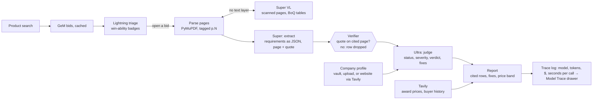

# Green Ink — Product and hackathon plan

Product, story, hackathon rules and timeline. The engineering design is in `docs/SPEC.md`; standing rules for coding agents are in `AGENTS.md`.

## Verdict

**Green Ink** finds government tenders a small manufacturer can actually win, then lists every clause that would get the bid rejected, with the page it sits on and the fix. It is submitted to the **Best Apps and Agents** track of the Nebius x NVIDIA Global AI Hackathon and also qualifies for **Best Use of Tavily** (a track award and a bonus can stack).

- **Pitch line:** "Small factories don't lose government tenders on price. They lose on page 37."
- **What a judge does:** types any product ("current transformer", "LED street light", "office chair"), sees live GeM bids ranked by whether a sample company can win them, opens one, and gets a cited rejection-risk report in under 60 seconds.
- **Why it wins:** a real user (the founder's own factory), a 30-second aha, four NVIDIA models each doing a visible job on Token Factory, and published evaluation numbers.
- **Hard deadline:** Oct 30, 2026, 10:00 PT = **Oct 30, 22:30 IST**. Internal deadline: submitted by Oct 30, 18:00 IST.

## The name

In Indian government offices, the senior officer who approves a file traditionally signs in green ink. Every small factory wants that signature; Green Ink gets them there.

- Tagline: **"Get to the green ink."**
- Brand cues: a green signature stroke as the logo, green ticks for what passes, red for what blocks the signature.

## Eligibility checklist (from the Official Rules and FAQ)

Miss any hard gate and the entry fails the Stage 1 pass/fail check.

**Hard gates**

- [ ] Registered on the hackathon page ("Join hackathon")
- [ ] Project makes a **runtime call to the Token Factory inference API** at `https://api.tokenfactory.nebius.com/v1/` (calling Nemotron via OpenRouter or Hugging Face does not count)
- [ ] Uses **at least one NVIDIA open model** (we use four Nemotron models)
- [ ] Fits the chosen track as a genuine attempt, not a rebrand of an unrelated project
- [ ] Project newly created during the submission period
- [ ] **Working demo URL**, free, no restriction, no login, kept live until **Dec 15, 2026, 12:00 PT** (end of judging)
- [ ] **Public GitHub repo** with all source, assets and run instructions
- [ ] **Open source licence** file at repo root (MIT), visible in the repo's About section
- [ ] **README** with setup steps, plus clear sections on which NVIDIA models are used, where Token Factory is used, and any other Nebius services
- [ ] **Demo video under 3:00**, public on YouTube, showing the project actually working
- [ ] Video has no copyrighted music and no third-party logos used without permission
- [ ] Text description: what it is, why, how it works, features and functionality
- [ ] Track selected: **Best Apps and Agents**
- [ ] **Feedback section** filled in for Token Factory, AI Cloud and each NVIDIA model used (required)
- [ ] All materials in English
- [ ] Submitted before **Oct 30, 22:30 IST**

**Bonus and scoring items**

- [ ] Tavily API called **functionally at runtime** (company profile + price intel) to qualify for Best Use of Tavily ($3,000)
- [ ] Token Factory and the Nemotron model names appear in the description, in "Built With", and **spoken aloud** in the video
- [ ] Model-to-task mapping visible in the UI (judges asked: "show which model is doing what")
- [ ] Limitations and failure cases published in the README and write-up

**Hygiene**

- [ ] No API keys in the repo: `.env` in `.gitignore`, secret scan before submitting
- [ ] Third-party data used within its terms: GeM listings are public, fetched at a low rate, cached, every bid links back to its official page
- [ ] Demo uses a **fictional company** (Brightline Electricals); no real partner names, DSC holder, turnover or customer prices
- [ ] Commits pushed from the founder's own GitHub account

## Judging criteria (equally weighted, scored 1–5)

1. **Technological implementation:** how well it is built and how effectively it uses Token Factory and NVIDIA models. Also the first tie-breaker.
2. **Design:** a complete, coherent product experience, not a proof of concept.
3. **Potential impact:** a credible, specific case for a real problem for a real audience, addressed by what is demonstrated.
4. **Quality of the idea:** creative, non-obvious use of the models; genuine understanding of the problem.

Judges' own advice: solve a real problem for a real audience; reach the aha within 30 seconds of the demo; one thing done well beats a big stack; show which model does what; publish limitations; budget time for packaging.

## Story

Told by the founder of a small electrical factory near Delhi that has been rejected from government tenders for reasons unrelated to its product.

1. **The person.** "I run a small electrical factory outside Delhi. We make current transformers that state utilities install in their substations."
2. **The wound.** Three real rejections:
   - a BoQ rejected as "invalid" because it was saved in LibreOffice instead of Excel;
   - a turnover certificate worded "Trading Business" when the tender wants a manufacturer;
   - a missing state contractor enlistment, discovered only after bidding.
3. **The insight.** The product was fine every time. The bid died on a clause buried deep in a long document. India reserves 25% of central procurement for micro and small firms, and small firms rarely have a bid team to catch these traps.
4. **The turn.** "So I built the bid reviewer we couldn't afford." Type a product, pick a tender, and Green Ink reads the whole document, checks each clause against your company's papers, shows every way the bid can fail, and drafts the fix.
5. **The proof and the scale.** Evaluation numbers on real tenders and cost per tender. It runs on open models because bid prices and company papers are confidential. The same engine works for any eligibility document: scholarships, schemes, licences.

Lines to reuse everywhere:
- "Small factories don't lose government tenders on price. They lose on page 37."
- "Every finding cites the page. If the quote isn't on that page, we don't show it."
- "Your bid price never leaves open infrastructure."

**What the audience must remember:** the red row that says *"Your certificate says Trading Business. Clause 4.2 requires a manufacturer. High rejection risk."* Design the whole demo around reaching that row fast.

## Product: what a judge can do

No login; a cited report in three clicks. P0 must ship; P1 if time allows; P2 is roadmap.

**Screen 1: Search.** One box: "What do you sell?"
- Any product returns live GeM bids: title, buyer, quantity, closing date, estimated value.
- Each bid carries a win-ability badge (green / amber / red) for the selected company, scored by Nemotron 3.5 Lightning from the bid's summary fields.
- Eight pre-cached suggestion chips (current transformer, LED street light, office chair, …).

**Screen 2: Company.** A switcher in the header:
- **Demo company** (default): *Brightline Electricals*, a fictional micro manufacturer of CTs and PTs with a document vault holding three deliberate traps: a certificate worded "Trading Business", no BIS licence, turnover just under a common threshold.
- **Build from a website:** paste a URL; Tavily Extract + Lightning build a draft profile, marked "unverified until documents are uploaded".
- **Upload documents:** PDFs or images; Super extracts them into the same profile schema.

**Screen 3: Report** (the money screen; streams in about 30–60 seconds):
- **Verdict card:** Bid / Fix then bid / Skip, with a one-line reason.
- **Requirements table:** requirement, what the company has, status (pass, fail, missing proof, unclear), severity, page-number chip.
- **Clickable citations:** open the side-by-side PDF viewer at that page with the quote highlighted.
- **Fix button** on each failing row: drafts a letter, checklist or document request.
- **Price panel:** past award prices for similar items, the buyer's history, where your quote sits (Tavily + GeM results, with sources).
- **Model Trace drawer:** each step with its model, tokens, cost in $, seconds.
- **Share link** and **Download PDF**.

| Feature | Priority |
| --- | --- |
| Product search over live GeM bids, with cache | P0 |
| Demo company with trap documents | P0 |
| Full-tender extraction with page-verified citations | P0 |
| Compliance verdict and requirements table | P0 |
| Model Trace drawer (model, tokens, cost, latency) | P0 |
| PDF viewer with highlighted clause | P0 |
| Fix drafts | P0 |
| Tavily price intel and buyer history | P0 (needed for the bonus) |
| Company from website (Tavily) | P1 |
| Document upload for your own company | P1 |
| Upload any tender PDF (state portals, CPPP) | P1 |
| Shareable report link, PDF export | P1 |
| Nightly bulk triage job and email digest | P2 |
| Hindi summary of the report | P2 |

**Production-grade means:** nothing blocks the screen for long (streaming progress steps); every error has a human message and a retry; second visits are instant from cache; the layout works on a phone; a rate limit protects the credits; every number on screen comes from a real call.

## Model routing (pipeline view)

| Job | Model (Token Factory) | Why | Price in / out per 1M tokens |
| --- | --- | --- | --- |
| Triage the bid list; company profile from a website | `nvidia/Nemotron-3_5-Lightning` (30B, 3B active, 1M context) | Cheapest and fast; runs on every search result | $0.06 / $0.24 |
| Extract requirements from the full tender as JSON with page and quote | `nvidia/nemotron-3-super-120b-a12b` | Strong instruction-following on long documents | $0.30 / $0.90 |
| Read scanned pages and BoQ tables with no text layer | `nvidia/Nemotron-3.5-Super-VL` | Vision; only on pages where text extraction fails | $0.30 / $0.90 |
| Compare clauses with the company, verdict inputs, draft fixes | `nvidia/Nemotron-3-Ultra-550b-a55b` | Hardest reasoning step, once per report | $1.00 / $3.00 |

Rough cost per report (40k-token tender): Super extraction ≈ $0.015, Ultra judgement ≈ $0.03, Lightning triage < $0.01 → **≈ $0.05 per tender**; $50 credits ≈ 1,000 reports. Confirm with real traces.

**GeM access:** public bid listings and documents live on `bidplus.gem.gov.in` (`/all-bids`, `/bidlists`, `/bidresultlists`, `/advance-search`, per-bid `showbidDocument/...` links). CPPP search sits behind a captcha, so CPPP and state portals (e.g. hptenders) go through "upload any tender PDF". Check whether GeM answers requests from a non-Indian server; if not, run the fetcher from an Indian host and push results to the database.

## Evaluation and limitations

A small, honest evaluation set is the strongest signal in Technological Implementation (the first tie-breaker).

**Build the set (Oct 29):**
- 20 GeM bids from electrical-equipment categories: CTs and PTs, meters, panels, cables, LED fittings.
- Hand-label every requirement that could disqualify a micro manufacturer, with its page number (`eval/tenders/labels.jsonl`).
- Use the Brightline profile as the fixed bidder for all 20.
- Add the three real rejection cases as named regression tests (`eval/regressions/`).

| Metric | Definition |
| --- | --- |
| Disqualifier recall | Share of labelled disqualifying requirements the report flags as fail, missing proof or unclear |
| Precision | Share of flagged rows a human agrees are real |
| Citation validity | Share of model quotes found on their cited page (before the verifier drops the rest) |
| Cost per tender | Total Token Factory $ from the trace |
| Latency per tender | Seconds from click to verdict |

Run three configurations: Lightning only, Super only, routed pipeline. `make eval` writes `eval/results.csv` and a chart.

**Limitations to publish as written:**
- Only GeM is searched live; other portals work by upload only.
- Scanned pages depend on vision accuracy; tables with merged cells can be misread.
- Hindi-only annexures aren't handled in this version.
- The company profile is only as good as the uploaded documents; website-built profiles are marked unverified.
- It is advisory: it does not replace reading the tender, and it never submits a bid.
- Price intel covers only publicly findable awards.

## Timeline

Production ships **Oct 28, 22:00 IST** (details per lane in `docs/SPEC.md`).

- [ ] **Oct 26:** Token Factory check, accounts, repo scaffold, **contracts frozen** (OpenAPI + Pydantic models), GeM spike
- [ ] **Oct 27:** three parallel lanes (pipeline, product, data and infra); end-to-end report on staging by midnight
- [ ] **Oct 28:** triage, Tavily intel, Model Trace, uploads, hardening, pre-warmed cache; production live at 22:00
- [ ] **Oct 29:** 20-bid evaluation in three configurations; record and edit the video
- [ ] **Oct 30:** README, write-up, feedback; run the eligibility checklist; submit by 18:00 IST

**Cut order if behind:** P2 items, then document upload, then company-from-website. Never cut the citation verifier, the Model Trace drawer or Tavily price intel.

## Demo video script (2:50)

| Time | On screen | Voice-over |
| --- | --- | --- |
| 0:00–0:20 | Factory floor, three rejection documents | "In Indian government offices, the officer who approves your file signs in green ink. We make current transformers near Delhi. Three times we never got that signature, and never because of the product." |
| 0:20–0:40 | Type "current transformer"; live GeM bids appear with badges | "Type what you sell. Green Ink pulls live government tenders and ranks which ones you can actually win." |
| 0:40–1:15 | Open an amber bid; report streams; red "Trading Business" row; click citation → PDF highlight | "It reads the whole tender and checks every clause against your documents. Here's the line that would have killed this bid." |
| 1:15–1:35 | Click Fix; drafted letter to the CA | "And it drafts the fix." |
| 1:35–1:55 | Price panel with Tavily sources | "Tavily pulls what this buyer paid before, so you price to win." |
| 1:55–2:20 | Model Trace drawer | "All on Nebius Token Factory: Nemotron 3.5 Lightning for triage, Nemotron 3 Super for extraction, Super VL for scanned pages, Nemotron 3 Ultra for the verdict." |
| 2:20–2:40 | Evaluation table, limitations | Real numbers only. |
| 2:40–2:50 | Logo, URL | "Small factories don't lose on price. They lose on page 37. Green Ink. Get to the green ink." |

## Submission write-up, README and feedback

**Devpost write-up skeleton** (mirrors the judging criteria): Inspiration · What it does · How we built it (Nebius Token Factory + NVIDIA Nemotron) · Design · Impact · Evaluation · Limitations · What's next.

**Built With:** nebius-token-factory, nvidia-nemotron, nemotron-3-ultra, nemotron-3-super, nemotron-3.5-lightning, nemotron-3.5-super-vl, tavily, python, fastapi, nextjs, postgresql.

**README outline:**
1. One-line pitch, demo URL, video link, screenshot
2. Quickstart: `cp .env.example .env`, set `NEBIUS_API_KEY` and `TAVILY_API_KEY`, `docker compose up`
3. **How we use NVIDIA Nemotron:** routing table with file paths to each call
4. **Where Token Factory accelerated us:** OpenAI-compatible API, one key for four models, cost per tender
5. Architecture diagram, pipeline, the verifier
6. Evaluation: method, table, `make eval`
7. Limitations
8. Data sources and terms
9. Licence (MIT)

**FEEDBACK.md:** for Token Factory, AI Cloud, Lightning, Super, Super VL and Ultra: what it was used for; what worked; what broke (exact error and endpoint); time from zero to first call; would we build with it again, and why. Keep notes as you go.

## Risks

| Risk | Prevention |
| --- | --- |
| Token Factory billing fails from India | Test on Day 0; Nebius Discord handles it case by case |
| Demo down or out of credits during judging (Dec 1–15) | Cache reports, per-IP rate limit, daily spend cap, always-on host, uptime monitor |
| GeM blocks foreign server IPs or changes its pages | Fetcher from an Indian host; cached corpus fallback; upload path |
| A model ID is retired before Dec 15 | Model IDs in config, fallback per task |
| Hallucinated clause on camera | Quote verifier; only verified rows render |
| Secret pushed to the public repo | `.env` ignored, gitleaks in CI |
| Real company data in the demo | Fictional Brightline company |
| Scope creep | Cut order; feature freeze Oct 28, 18:00 IST |
