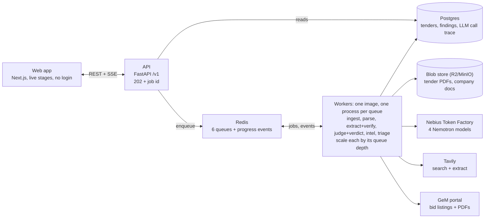

# Green Ink — Engineering spec

This is the source of truth for how Green Ink is built. Read it fully before writing code. Product context, story and hackathon rules are in `docs/PLAN.md`; standing rules for coding agents are in `AGENTS.md`.

## Decision

Build Green Ink as a **modular monolith driven by queues**: one codebase and one container image, split into modules with typed interfaces. Each worker type runs as its own process, so you scale it independently by queue depth. A demo-ready production deploy goes live by **Oct 28, 22:00 IST**.

Microservices in two days would mean two days of plumbing. A modular monolith gives the same seams:

- any module can later be pulled out into its own service by swapping an in-process call for a queue or HTTP call;
- nothing in the domain code changes when that happens.

**Review of the v1 plan: what changed**

| v1 plan | Problem | v2 decision |
| --- | --- | --- |
| One request runs the whole pipeline | A 60-second request ties up the API; one slow model call blocks everything | API returns 202 at once; stages run as queued jobs; progress streams over SSE |
| Extraction run per report | Paying Super again for every company that opens the same tender | **Extract once per tender** (keyed by document hash and extractor version); only judging runs per company |
| Ultra writes the verdict in free text | Not auditable; it can drift between runs | Ultra judges **each requirement**; the verdict (Bid / Fix then bid / Skip) is computed by code from the findings |
| Model IDs inside code | A retired model breaks production | Routing table in config: task → model → fallback, swappable without a deploy |
| GeM calls scattered through the code | Adding CPPP or state portals means rewrites | `SourceAdapter` interface: GeM now, upload now, CPPP and state portals later |
| Ship Oct 29, package Oct 30 | No buffer when something breaks | Ship Oct 28; Oct 29 is evaluation and video; Oct 30 is submission only |
| "Build it fast" | Parallel AI coding agents collide | **Contract first**: freeze the schemas and the OpenAPI spec on Oct 26 night, then three lanes build against them |

## System design



The API only reads Postgres and enqueues jobs; all model, Tavily and GeM traffic happens in workers, so a slow model never blocks a page load.

## Modules and interfaces

Each module owns one job and exposes one port (a Python `Protocol`). Other modules depend only on the port, never on the implementation behind it. Adapters are chosen in config, so a swap is a config change plus a new class.

| Module | Owns | Port (interface) | Day-one adapter | Swap to later |
| --- | --- | --- | --- | --- |
| `sources` | Finding tenders and fetching their documents | `SourceAdapter.search(q) / fetch(ref) -> TenderDoc` | GeM bidplus, manual upload | CPPP, state NIC portals, SAM.gov, EU TED |
| `docs` | PDF to page-tagged text, with OCR fallback | `Parser.parse(bytes) -> Pages` | PyMuPDF + Nemotron 3.5 Super VL | Nemotron Parse, layout model on a Nebius endpoint |
| `llm` | Every model call: routing, retries, JSON validation, cost, trace | `LLM.run(task, input, schema) -> Result` | Token Factory | Nebius dedicated endpoint, fine-tuned Nemotron |
| `analysis` | Extract, verify, judge, fixes, verdict rules | `Extractor`, `Verifier`, `Judge`, `Fixer` | Super / code / Ultra / Ultra | Smaller tuned models per category |
| `companies` | Company profile, document vault, facts | `ProfileBuilder.from_docs / from_url` | Super extraction, Tavily + Lightning | Registry data such as Udyam or GST, where allowed |
| `intel` | Price bands, buyer history | `IntelProvider.prices(item, buyer)` | Tavily Search + Extract, GeM bid results | Own award-price index built over time |
| `triage` | Fast win-ability scoring of search results | `Triage.score(bids, profile)` | Nemotron 3.5 Lightning | Embedding pre-filter + Lightning |
| `storage` | Blobs (PDFs, exports) | `BlobStore.put/get` | Cloudflare R2 (S3 API); MinIO locally | Nebius Object Storage (S3 API) |
| `jobs` | Queue, retries, events | `enqueue(stage, key, payload)` | Redis + arq | Redis Streams cluster, or Kafka at scale |
| `api` | HTTP + SSE for the web app and partners | OpenAPI 3.1 spec | FastAPI | Same, plus API keys for partners |
| `web` | The product UI | Typed client generated from OpenAPI | Next.js | Same |

**Rule that keeps it modular:** modules talk across boundaries only through the port or the queue, and only `api` and the workers import adapters. Enforce it with `import-linter` in CI so the boundaries can't rot.

## Repo layout

The repo is a monorepo: a `uv` workspace for Python and `pnpm` for the web app. Everything runs locally with one `docker compose up`.

```
greenink/
├── LICENSE                     # MIT, at root so GitHub shows it in About
├── README.md
├── AGENTS.md                   # standing rules for coding agents
├── FEEDBACK.md                 # running notes for the required feedback section
├── .env.example                # NEBIUS_API_KEY, TAVILY_API_KEY, DATABASE_URL, REDIS_URL, R2_*
├── docker-compose.yml          # postgres, redis, minio, api, worker, web
├── Makefile                    # dev, test, lint, eval, seed, openapi, migrate, check-models
├── docs/
│   ├── PLAN.md                 # product, story, hackathon rules, timeline
│   └── SPEC.md                 # this file
├── contracts/
│   ├── openapi.yaml            # frozen on Oct 26 night; web client generated from it
│   └── schemas/                # JSON Schemas shared with the LLM gateway
├── config/
│   ├── models.yaml             # task -> model -> fallback, budgets, timeouts
│   └── sources.yaml            # enabled adapters, rate limits
├── apps/
│   ├── api/                    # FastAPI app: routes, SSE, sessions, rate limit
│   ├── worker/                 # one entrypoint; --queues picks ingest, parse, extract, judge, intel, triage
│   └── web/                    # Next.js 15, Tailwind, react-pdf
├── packages/greenink/          # the domain, as importable Python modules
│   ├── core/                   # Pydantic models, errors, ids, settings
│   ├── sources/  gem.py, upload.py, base.py
│   ├── docs/     parse.py, ocr.py
│   ├── llm/      gateway.py, router.py, pricing.py, trace.py
│   ├── analysis/ extract.py, verify.py, judge.py, fixes.py, verdict.py, prompts/
│   ├── companies/ profile.py, from_url.py
│   ├── intel/    tavily.py, gem_results.py
│   ├── triage/   score.py
│   ├── storage/  blob.py
│   ├── jobs/     queue.py, events.py
│   └── db/       models.py, migrations/ (alembic)
├── scripts/                    # check_models.py, gem_spike.py, seed.py
├── seed/
│   └── brightline/             # fictional demo company documents, incl. the 3 traps
├── eval/
│   ├── tenders/                # 20 bid PDFs + labels.jsonl
│   ├── run.py                  # runs configs, writes results.csv + chart
│   └── regressions/            # 3 real rejection cases
├── infra/
│   ├── Dockerfile              # one image; CMD picks api or a worker
│   ├── fly.toml                # or railway.json
│   └── nebius-job/             # P2: nightly triage as a Nebius Serverless Job
└── .github/workflows/ci.yml    # ruff, mypy, pytest, import-linter, gitleaks
```

## Data model

Tender-side work is computed once per document and shared by every company. Company-side work is computed once per tender × company pair. That split is what keeps cost flat as users grow. Postgres holds everything except PDFs, which go in blob storage.

| Table | Key columns | Written by | Scope |
| --- | --- | --- | --- |
| `tenders` | `id`, `source`, `source_ref` (unique together), title, buyer, value, closes_at, `meta` jsonb | `sources` | Per tender |
| `tender_documents` | `id`, `tender_id`, `sha256` (unique), blob_key, page_count | `sources` | Per document |
| `pages` | `document_id`, `page_no`, text, `method` (text / vision) | `docs` | Per document |
| `requirements` | `id`, `document_id`, `extractor_version`, category, text, `page_no`, `quote`, `verified` bool | `analysis.extract`, `verify` | **Per document, shared** |
| `companies` | `id`, name, `profile` jsonb, `source` (demo / docs / url), `verified_level`, `session_id` | `companies` | Per company |
| `company_documents` | `id`, `company_id`, kind, blob_key, `facts` jsonb | `companies` | Per company |
| `analyses` | `id`, `tender_id`, `company_id`, `status`, `verdict`, `profile_hash`, `requirements_version` | `analysis` | **Per tender × company** |
| `findings` | `id`, `analysis_id`, `requirement_id`, status, severity, `evidence` jsonb, `fix` jsonb | `analysis.judge` | Per analysis |
| `price_intel` | `analysis_id`, item, band_low, band_high, `sources` jsonb | `intel` | Per analysis |
| `llm_calls` | `id`, `analysis_id`?, task, model, tokens_in, tokens_out, cost_usd, latency_ms, status, prompt_hash | `llm` | Per call |
| `job_events` | `analysis_id`, `stage`, `state`, `message`, `at` | `jobs` | Per stage |

Enums:
- Requirement category: `turnover`, `experience`, `mse_exemption`, `startup_exemption`, `oem_authorisation`, `bis_certification`, `type_test`, `emd`, `epbg`, `document`, `delivery`, `atc`, `boq_format`, `other`.
- Finding status: `pass`, `fail`, `missing_proof`, `unclear`. Severity: `critical`, `high`, `medium`, `low`.
- Verdict: `bid`, `fix_then_bid`, `skip`.
- Analysis status: `queued`, `running`, `done`, `partial`, `failed`.

**Cache keys** (the reason the second visit is instant):

- Extraction: `(document.sha256, extractor_version)`. Re-extract only when the prompt or model changes.
- Analysis: `(tender_id, company_id, profile_hash, requirements_version)`. Editing a company document changes the hash and re-judges.
- Search: `(adapter, normalised query)` in Redis with a 30-minute TTL.
- LLM: `prompt_hash` lookup in `llm_calls` for exact repeats.

## Pipeline and jobs

Each stage is an idempotent job on its own queue. A stage that finds its output already stored under its key skips straight to the next stage. That makes retries safe and reruns free.

| Stage | Queue | Idempotency key | Does | Next |
| --- | --- | --- | --- | --- |
| 1. Fetch | `q.ingest` | `source:source_ref` | Download the document, hash it, store the blob | Parse |
| 2. Parse | `q.parse` | `sha256` | Page text; vision on pages with under 50 characters of text | Extract |
| 3. Extract | `q.extract` | `sha256:extractor_version` | Super returns requirements with page + quote | Verify |
| 4. Verify | inline in extract worker | same | Fuzzy-match each quote on its page (rapidfuzz partial_ratio ≥ 90); mark `verified` | Judge |
| 5. Judge | `q.judge` | `analysis_id` | Ultra judges verified requirements against the profile; Fixer drafts fixes for fails | Verdict |
| 6. Verdict | inline | same | Code rules → Bid / Fix then bid / Skip | Done |
| 6b. Intel | `q.intel` (parallel to 3–6) | `analysis_id` | Tavily + GeM results → price band | Done |
| Triage | `q.triage` | `query_hash:company_id` | Lightning scores the search results in batches of 20 | — |

**Verdict rules** (in `analysis/verdict.py`, unit-tested):

- Any `critical` fail with no fix possible before the closing date → **Skip**.
- Any `critical` or `high` fail, or missing proof, that can be fixed → **Fix then bid**.
- Otherwise → **Bid**.
- Every rule cites the findings that triggered it.

**Events:** each stage writes `job_events` and publishes to Redis channel `analysis:{id}`. The API relays them to the browser over SSE, so the report fills in live ("Reading 64 pages… 41 requirements found… 3 risks").

**Failures:** 3 retries with exponential backoff per stage. After that, the stage is marked `failed` with a human message, and the report shows the stages that did finish.

## API contract

The API is versioned under `/v1` and described in `contracts/openapi.yaml` before any code is written; the web client is generated from it. Long work always returns `202` with an id, never a held-open request.

| Method | Path | Returns | Notes |
| --- | --- | --- | --- |
| GET | `/v1/search?q=&company_id=` | Bids with triage badges | Cached 30 min; badges fill in via `/v1/search/{id}/events` |
| GET | `/v1/search/{id}/events` | SSE stream | Triage badge updates |
| GET | `/v1/tenders/{id}` | Tender metadata + document link | |
| GET | `/v1/tenders/{id}/pages/{n}` | Page text for the viewer | Used for highlight |
| POST | `/v1/tenders/upload` | `202` + tender id | PDF ≤ 25 MB; for non-GeM portals |
| GET | `/v1/companies` | Demo + your companies | |
| POST | `/v1/companies` | Company | Manual profile |
| POST | `/v1/companies/{id}/documents` | `202` | Upload a vault document |
| POST | `/v1/companies/from-url` | `202` + company id | Tavily-built, marked unverified |
| POST | `/v1/analyses` | `202` + analysis id | Body: `tender_id`, `company_id`; returns the cached analysis if the key matches |
| GET | `/v1/analyses/{id}` | Full report | Verdict, findings, intel, stage states |
| GET | `/v1/analyses/{id}/events` | SSE stream | Stage progress |
| GET | `/v1/analyses/{id}/trace` | LLM calls | Model, tokens, $, ms |
| POST | `/v1/analyses/{id}/findings/{fid}/fix` | Drafted fix | Generated on demand, then cached |
| GET | `/v1/analyses/{id}/export.pdf` | PDF report | P1 |
| GET | `/healthz`, `/readyz` | Status | Uptime monitor pings these |

Errors follow one shape: `{code, message, retryable}`. That is the same contract the frontend shows to users, so there are no raw stack traces.

## LLM gateway

Every model call goes through `llm.run(task, input, schema)`. No other module knows a model name, a price or an endpoint. That makes the gateway the single place to change models, add fallbacks, cap spend and produce the Model Trace the judges see.

```yaml
# config/models.yaml  (IDs to confirm with scripts/check_models.py on Day 0)
provider:
  base_url: https://api.tokenfactory.nebius.com/v1/
  api_key_env: NEBIUS_API_KEY
tasks:
  triage:        {model: nvidia/Nemotron-3_5-Lightning,      fallback: nvidia/nemotron-3-super-120b-a12b, timeout_s: 20,  max_concurrency: 16}
  profile_url:   {model: nvidia/Nemotron-3_5-Lightning,      fallback: nvidia/nemotron-3-super-120b-a12b, timeout_s: 30}
  extract:       {model: nvidia/nemotron-3-super-120b-a12b,  fallback: nvidia/Nemotron-3-Ultra-550b-a55b, timeout_s: 120, max_concurrency: 6}
  page_vision:   {model: nvidia/Nemotron-3.5-Super-VL,       timeout_s: 60,  max_concurrency: 4}
  judge:         {model: nvidia/Nemotron-3-Ultra-550b-a55b,  fallback: nvidia/nemotron-3-super-120b-a12b, timeout_s: 120, max_concurrency: 4}
  fix:           {model: nvidia/Nemotron-3-Ultra-550b-a55b,  fallback: nvidia/nemotron-3-super-120b-a12b, timeout_s: 60}
pricing_usd_per_1m:   # input / output; from tokenfactory.nebius.com/endpoints, recheck
  nvidia/Nemotron-3_5-Lightning:      {in: 0.06, out: 0.24}
  nvidia/nemotron-3-super-120b-a12b:  {in: 0.30, out: 0.90}
  nvidia/Nemotron-3.5-Super-VL:       {in: 0.30, out: 0.90}
  nvidia/Nemotron-3-Ultra-550b-a55b:  {in: 1.00, out: 3.00}
budgets:
  per_analysis_usd: 0.25      # hard stop; report shows partial results
  daily_usd: 5.00             # protects credits through Dec 15
```

**What the gateway does on every call**

1. **Routing:** look up the task, then call the model; on timeout or a 5xx, retry twice, then use the fallback model. The trace records which model actually answered.
2. **Structured output:** request JSON matching the Pydantic schema (JSON mode or tool calling, whichever `supported_features` lists for that model). Validate it; on failure, make one repair call with the validation error attached.
3. **Concurrency:** apply a per-model semaphore from `max_concurrency`, so a burst of searches can't trip Token Factory rate limits.
4. **Budget:** check the spend so far before calling; refuse with `budget_exceeded` if over.
5. **Trace:** write `llm_calls` with tokens, cost (from the price table), latency and `prompt_hash`. Exact repeats are served from that cache.

**Prompts** live as versioned files in `analysis/prompts/` (for example `extract.v1.md`). The version is part of the cache key, so changing a prompt invalidates exactly what it should. Tender text always goes in a delimited data block, with the instruction that it is content to analyse, never instructions to follow.

## Scaling and reliability

Every runtime piece is stateless and reads its work from a queue, so scaling any part up or down means changing a replica count. The bottleneck at any size is model throughput, which the gateway's semaphores and budgets control.

| Component | Scales on | Hackathon size | Grows to | When it fails |
| --- | --- | --- | --- | --- |
| `web` (Vercel or Netlify) | Requests, automatically | Free tier | CDN, edge | Static shell still loads; API errors shown inline |
| `api` | CPU / requests | 1 replica | N replicas behind the load balancer | Health check restarts it; SSE clients reconnect with `Last-Event-ID` |
| `worker` on `q.ingest` | Queue depth | 1 | N; one source's rate limit per adapter | Search falls back to cached corpus |
| `worker` on `q.parse` | Queue depth, CPU | 1 | N, CPU-heavy | Retry; then mark page unreadable |
| `worker` on `q.extract` / `q.judge` | Queue depth; capped by model concurrency | 1 each | N, until Token Factory limits; then a dedicated endpoint | Fallback model; then partial report |
| `worker` on `q.intel` | Queue depth | 1 | N | Report ships without the price band |
| Postgres (Neon) | Storage, connections | Free tier | Bigger instance, read replica | Managed backups; point-in-time restore |
| Redis (Upstash) | Ops/s | Free tier | Paid tier, then a cluster | Jobs persist in Postgres `job_events`; re-enqueue on restart |
| Blob store (R2) | Bytes | Free tier | Unlimited | PDFs can be fetched again from source |

**For the hackathon,** run all workers as one process listening on every queue (`worker --queues all`). After the hackathon, split them by changing the start command. No code changes.

**Keeping the demo alive until Dec 15:**

- an uptime monitor (Better Stack or UptimeRobot, free) on `/readyz`;
- a daily spend cap in the gateway;
- per-IP rate limit of 10 analyses an hour;
- 20 pre-warmed reports that cost nothing to re-open;
- a budget alert in Token Factory if it offers one.

## Security and data handling

Company documents and bid prices are the product's reason to exist on open infrastructure, so treat them as confidential from day one.

- **No login for judges:** an anonymous session in a signed cookie. Companies a visitor creates are private to that session. The demo company is read-only and shared.
- **Secrets** only in environment variables. Commit `.env.example`, never `.env`. CI runs `gitleaks` on every push.
- **Uploads:**
  - PDF and images only, up to 25 MB, type checked from the file's bytes rather than its name;
  - parsed in the worker, never in the API;
  - stored under random keys and served through short-lived signed URLs.
- **Untrusted text:** tender and website text can contain instructions. Prompts wrap it as data, outputs are schema-validated, and the verifier drops any claim without a matching quote.
- **Third-party data:**
  - GeM is fetched at a polite rate (1 request a second, cached), with a user agent naming the project;
  - every bid links back to its official page;
  - Tavily results are cited in the price panel.
- **Personal data:** the demo company is fictional. Real users' documents can be deleted with one call, and analyses go with them (cascade delete).
- **Abuse:** per-IP rate limits on search and analysis, and the daily spend cap in the gateway.

## Ship plan, Oct 26–28

Production ships **Oct 28, 22:00 IST**. Three lanes run in parallel, each driven by one AI coding agent, with Amit as reviewer and integrator. Freezing the contracts on Oct 26 is what lets them run without colliding.

**Oct 26, 16:00–24:00: foundations and contracts (single lane)**

- [ ] Token Factory check passes for all four models; IDs written into `config/models.yaml`
- [ ] Tavily key; Neon, Upstash and R2 accounts; GitHub repo with MIT licence, `.gitignore`, CI skeleton
- [ ] Repo scaffold as in Repo layout; `docker compose up` brings up postgres, redis, minio, api and worker
- [ ] **Freeze** `contracts/openapi.yaml` and the Pydantic models: `Tender`, `Requirement`, `CompanyProfile`, `Finding`, `Analysis`, `LLMCall`
- [ ] GeM spike: search + fetch 30 electrical bid PDFs from a local machine and from a cloud host; note whether the cloud host is blocked
- [ ] Read 5 bids by hand; write the first `extract.v1.md` prompt from what you see

**Oct 27: three lanes, integrate at 21:00**

| Lane | Agent builds | Done when |
| --- | --- | --- |
| A. Pipeline | `llm` gateway with routing, retries, schema repair, trace; `docs.parse` with vision fallback; `extract` + `verify`; `judge` + `verdict` rules + tests; `fixes` | `make run-one BID=…` prints a correct, cited report for 3 bids |
| B. Product | API routes + SSE + rate limit; web: search screen, company switcher, report screen with streaming stages, requirements table, PDF viewer with highlight | Search → open bid → report fills live, against mocked worker events |
| C. Data and infra | GeM adapter with cache; upload adapter; Brightline seed documents with the 3 traps; alembic migrations; Dockerfile; deploy api + worker to Fly or Railway, web to Vercel | Staging URL live; seed loaded; a GeM search returns real bids |

- [ ] 21:00–24:00: wire the lanes together on staging; one real end-to-end report on the deployed stack

**Oct 28: complete the product, then harden**

- [ ] Lane A: Lightning triage badges; `intel` with Tavily Search + Extract and GeM results; cost and latency numbers in the trace
- [ ] Lane B: Model Trace drawer; price panel; Fix button flow; company-from-URL; tender upload; mobile layout; empty and error states
- [ ] Lane C: uptime monitor; spend caps; per-IP limits; pre-warm 8 searches and 20 reports; README draft; `FEEDBACK.md` filled from notes
- [ ] 18:00: code freeze for features; bug fixes only
- [ ] 22:00: **production live**, checked in an incognito window on a laptop and a phone

**Definition of done on Oct 28** (all must be true)

- [ ] A stranger can search any product, open a bid and get a cited report with a verdict in under 60 seconds, without logging in
- [ ] Every finding's page citation opens the PDF on that page with the quote highlighted
- [ ] The trace shows four Nemotron models by name, with tokens, $ and seconds
- [ ] Tavily is called at runtime and its sources show in the price panel
- [ ] A second open of the same report is instant from cache
- [ ] Killing a worker mid-report leads to a retry, not a broken page
- [ ] Public repo has the MIT licence, README, no secrets; CI is green

**Oct 29 and 30** follow `docs/PLAN.md`: evaluation run and video on Oct 29, write-up and submission by Oct 30, 18:00 IST.
